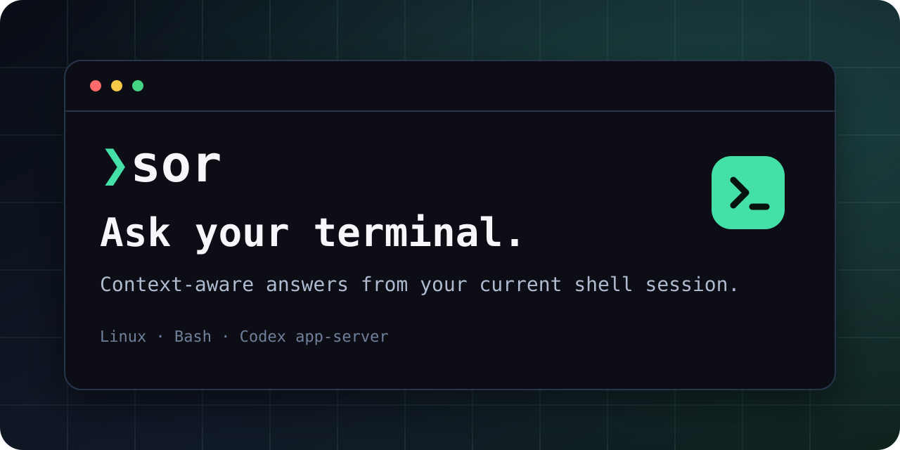

<p align="center">
  
</p>

<p align="center">
  <a href="https://github.com/fadayat/sor-terminal-assistant/stargazers"></a>
  <a href="https://github.com/fadayat/sor-terminal-assistant/actions/workflows/ci.yml"></a>
  <a href="LICENSE"></a>
  
  
  
</p>

**Sor** (`sor` means “ask” in Azerbaijani) is a context-aware terminal companion for Codex. It uses the command and output already visible in your current shell session to explain errors, suggest a fix, or write a command for you to review.

Sor runs as a normal shell command and connects to a locally authenticated Codex app-server. It is designed to stay close to your terminal workflow: ask a question, get a streamed answer, and keep control of what runs.

```bash
sor "Why did the last command fail?"
sor fix
sor cmd "show the largest files in this directory"
```

Suggested commands are printed as text. Sor does not execute them.

> **Early-stage software:** Sor is under active development. Today, automatic session capture is for interactive Bash sessions in VTE-based terminals on Linux. Context matching and secret redaction are best-effort; see [Privacy and session capture](#privacy-and-session-capture).

## Why Sor

- **Ask where the problem happened.** Stay in the terminal instead of copying long output into another window.
- **Send focused context.** Sor matches your question to recent command/output blocks locally before contacting the model.
- **Keep execution under your control.** Suggested commands are printed for review and never run automatically.
- **Use your existing Codex sign-in.** Sor talks to the local Codex app-server rather than implementing a separate hosted account system.
- **See the privacy boundary.** Pause, clear, or omit session context at any time.

## What it does

- Captures command metadata and terminal output for the current session.
- Selects recent commands and locally matched older output for ordinary questions, without making an extra model request.
- Streams answers from the configured Codex app-server model.
- Offers `ask`, `fix`, `cmd`, `deep`, and `full` modes.
- Keeps session logs in a private temporary directory and removes them when the terminal session exits.

```text
Bash session → private PTY log → local context selection and redaction
             → Codex app-server → streamed answer in the same terminal
```

## Where Sor is heading

Sor currently supports a locally authenticated Codex app-server. The planned provider layer will make the terminal experience independent from one backend:

- OpenAI API access with a user-supplied API key loaded from the environment or another secure local source.
- Configurable OpenAI-compatible endpoints for supported local and self-hosted models.
- Evaluated adapters for popular local runtimes such as Ollama, LM Studio, and llama.cpp.
- Multiple named provider profiles with explicit model, endpoint, and reasoning settings.
- Provider-aware context limits, streaming, health checks, and clear error reporting.

These are roadmap items, not current features. Provider support will only be marked as shipped after implementation and testing. See [ROADMAP.md](ROADMAP.md) for the full plan.

## Quick start

### Requirements

- Linux, Bash, and a VTE-based terminal for automatic session capture.
- Python 3.11 or newer and the `websockets` package.
- Codex CLI installed and signed in, with its local app-server available.

### Install

Clone this repository, then run:

```bash
git clone https://github.com/fadayat/sor-terminal-assistant.git
cd sor-terminal-assistant
./install.sh
```

The installer places Sor's commands in `~/.local/bin` and adds the Bash hook to `~/.bashrc.d`. Make sure `~/.local/bin` is on your `PATH` and your `~/.bashrc` sources files from `~/.bashrc.d`; then open a new terminal.

To install manually:

```bash
mkdir -p "$HOME/.local/bin" "$HOME/.bashrc.d"
install -m 0755 bin/sor "$HOME/.local/bin/sor"
install -m 0755 bin/sor-session-recorder "$HOME/.local/bin/sor-session-recorder"
install -m 0755 bin/sor-session-event "$HOME/.local/bin/sor-session-event"
install -m 0644 bash/sor-session.bash "$HOME/.bashrc.d/sor-session.bash"
```

The Bash hook must be sourced by `~/.bashrc`. Start a new terminal and check the setup:

```bash
sor --status
sor "Hello, how are you?"
```

## Usage

```bash
sor "Why did this command fail?"       # Ask with current terminal context
sor                                    # Explain the last completed command
sor fix                                # Diagnose and suggest a safe correction
sor cmd "find files larger than 1 GB"  # Return a shell command only
sor deep "explain this build failure"  # Larger context and high reasoning
sor full "review the recent output"    # Raw recent terminal context
sor --last 5 "what happened?"          # Include up to five recent command records
sor --no-context "what does tar do?"   # Ask without terminal history
```

Session controls:

```bash
sor --status
sor pause   # Stop recording context for this terminal
sor resume  # Resume recording
sor clear   # Clear the current terminal's recorded context
```

Ordinary questions use local relevance matching over the recent session log. Sor prioritizes recent commands and includes older output when its words match the question. It sends up to 30,000 characters, including a small tail of output outside command blocks. `deep` and `full` send up to 60,000 characters of recent raw terminal context; `deep` also uses high reasoning. If Sor cannot safely associate recent output with its command markers, it falls back to the raw recent context.

## Configuration

Sor reads `~/.config/sor/config.toml`, or `$XDG_CONFIG_HOME/sor/config.toml` when `XDG_CONFIG_HOME` is set. Environment variables override file values.

```toml
[provider]
name = "Codex"
codex_home = "~/.codex"
# codex_bin = "/path/to/codex" # Optional; otherwise resolved from PATH
model = "gpt-6-luna"
effort = "low"
work_dir = "/tmp"
```

Supported environment overrides:

| Variable | Purpose |
| --- | --- |
| `SOR_PROVIDER_NAME` | Display name for the provider |
| `SOR_CODEX_HOME` | Codex home directory |
| `SOR_CODEX_BIN` | Codex executable path; defaults to PATH lookup |
| `SOR_MODEL` | Model name |
| `SOR_EFFORT` | Default reasoning effort |
| `SOR_WORK_DIR` | Working directory passed to app-server |

Defaults are the standard `~/.codex` home, Codex CLI resolved from `PATH`, `gpt-6-luna`, `low` reasoning, and `/tmp` as the app-server working directory. The selected Codex home must already be signed in and have an app-server daemon Sor can reach.

## Privacy and session capture

Sor records the current terminal session locally. The log and command metadata live under `$XDG_RUNTIME_DIR/sor-sessions`, or a per-user directory under `/tmp` if `XDG_RUNTIME_DIR` is unavailable. The directory is private, files are created with owner-only permissions, and the session files are removed when the terminal recorder exits.

Terminal context is sent to the configured model **only when you invoke `sor`**. `sor --no-context` omits it. `sor pause` stops recording for the current terminal; `sor clear` truncates its current context.

Sor redacts common bearer tokens, sensitive environment assignments, recognized GitHub/OpenAI token formats, and private-key blocks before building the prompt. This is best-effort pattern matching, not a guarantee that every secret will be found. Review your terminal output before sending it, and use `--no-context` when you do not want the session included.

Command/output boundaries use invisible terminal markers and are best-effort. Older sessions, missing markers, and incomplete blocks use the raw-tail fallback. Sor reads only the session paths passed by its recorder; it does not inspect other terminal sessions or project files for a normal question.

## Troubleshooting

- **`sor: command not found`** — confirm `~/.local/bin` is on `PATH`, then open a new terminal.
- **No terminal context / zero command records** — use a new interactive Bash terminal in a VTE-based terminal and check `sor --status`. Other shells are not currently supported for automatic capture.
- **Codex app-server connection error** — verify Codex CLI is installed, signed in under the configured Codex home, and available on `PATH` or through `SOR_CODEX_BIN`.
- **The last command is missing** — Bash history settings such as `HISTCONTROL`, or exiting before the next prompt, can prevent a command record from being written. Sor then uses the raw-tail fallback when possible.
- **Too much or sensitive context** — use `sor --no-context`, `sor pause`, or `sor clear` before asking.

## Development

The implementation is Python plus a small Bash integration. The main files are:

- `bin/sor` — CLI, app-server client, context selection, and redaction.
- `bin/sor-session-recorder` — PTY recorder and session-file lifecycle.
- `bin/sor-session-event` — structured command-event writer.
- `bash/sor-session.bash` — interactive Bash hooks.
- `tests/` — focused unit and PTY integration tests.

Run the current test suite with:

```bash
python3 -m unittest discover -s tests -v
```

See [ROADMAP.md](ROADMAP.md) for shipped capabilities and planned work. Bug reports should include the command used, expected behavior, actual behavior, and relevant sanitized output. Do not attach terminal logs containing credentials or personal data.

See [CONTRIBUTING.md](CONTRIBUTING.md) before proposing a larger change. Security-sensitive reports should follow [SECURITY.md](SECURITY.md).

## License

Sor is licensed under the [MIT License](LICENSE).
